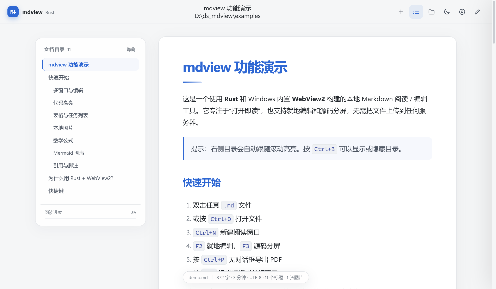
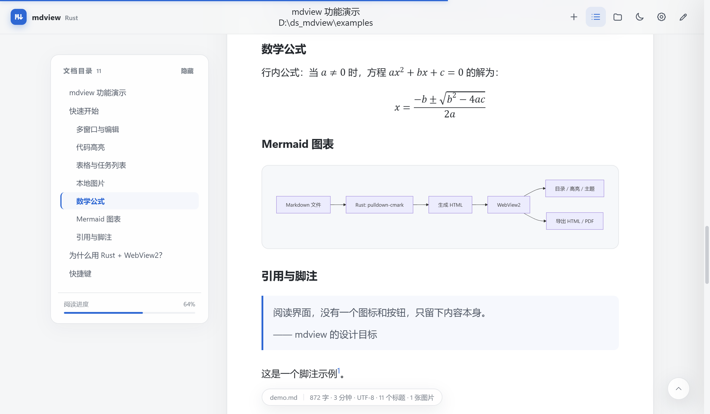
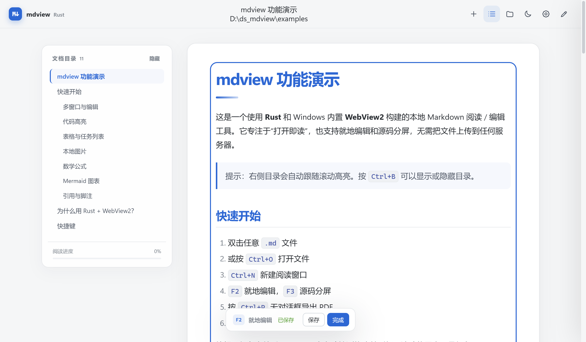
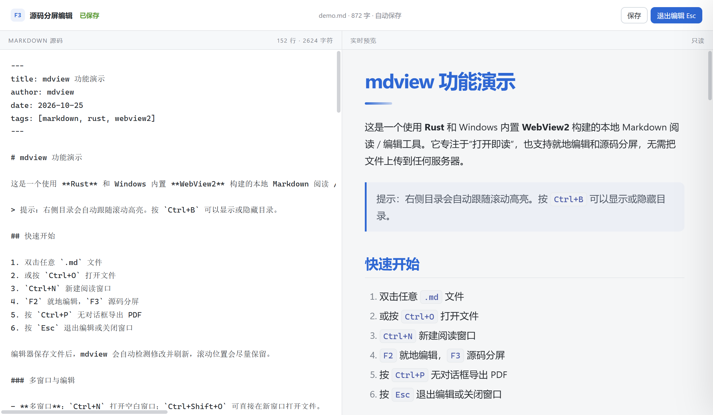
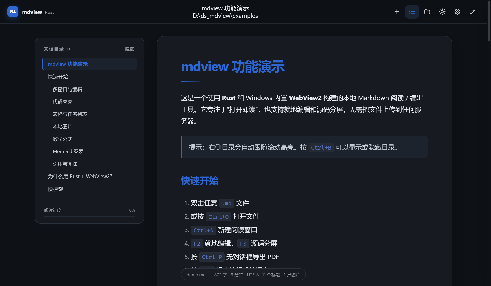
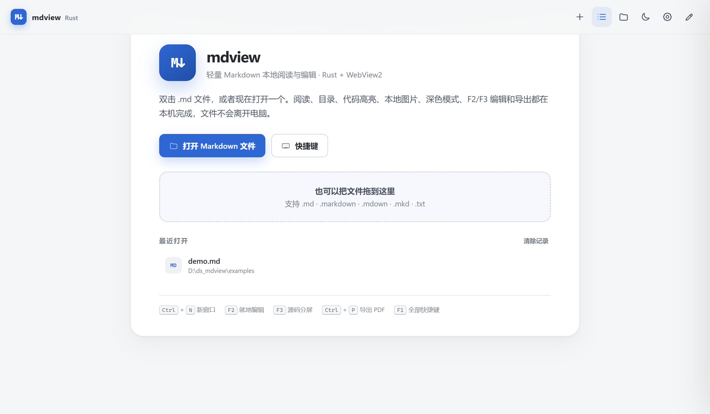

# mdview · Rust + Windows WebView2

[](https://github.com/henry-202308/mdview/actions/workflows/ci.yml)
[](https://github.com/henry-202308/mdview/releases)
[](LICENSE)


一个用 **Rust** 和 Windows 内置 **WebView2** 实现的轻量本地 Markdown 阅读 / 编辑工具。双击 `.md` 即可阅读，F2/F3 可以就地编辑和源码分屏编辑；Markdown 渲染在 Rust 中完成，界面资源全部离线内置，不启动本地 HTTP 端口，也不上传文件。



## 功能

| 功能 | 说明 |
| --- | --- |
| 多窗口 | `Ctrl+N` 新建独立窗口；`Ctrl+Shift+O` 在新窗口打开文件 |
| F2 就地编辑 | 直接修改渲染后的正文，自动保存；表格、任务列表、代码块可编辑，图片原样保留 |
| F3 源码分屏 | 左侧 Markdown、右侧实时预览，同步滚动，自动保存 |
| 双击 / 拖放打开 | 支持 `.md` `.markdown` `.mdown` `.mkd` `.mdx` `.txt` |
| GitHub 风格 Markdown | 表格、任务列表、删除线、脚注、引用提示块 |
| 文档目录 | 自动提取 H1–H4，点击跳转，滚动高亮当前章节 |
| 阅读进度 | 顶部细进度条 + 目录面板百分比 |
| 代码高亮 | 离线 highlight.js，包含 PowerShell、批处理等常用语言，支持一键复制 |
| 本地图片 | PNG / JPG / SVG / GIF / WebP / BMP / ICO / AVIF，通过应用内协议加载 |
| 深色 / 浅色 | 跟随系统或手动切换，偏好自动保存 |
| 8 套配色 | GitHub、小红书、科技、少女、多彩、Duolingo、Linear、Notion |
| 阅读设置 | 字号、版心宽度、无衬线 / 衬线字体、目录开关 |
| 数学公式 | 离线 KaTeX，支持 `$...$`、`$$...$$`，输出 MathML |
| Mermaid 图表 | 流程图 / 时序图等，离线渲染，跟随主题重绘 |
| 单文件 HTML 导出 | 本地图片、数学公式、Mermaid 一并内嵌，对方浏览器双击即可看 |
| 无对话框 PDF | `Ctrl+P` 直接调用 WebView2 `PrintToPdf`，自动生成同名 `.pdf` |
| 系统打印 | `Ctrl+Shift+P` 打开系统打印界面 |
| 自动刷新 | 编辑器保存文件后自动重新渲染，尽量保留滚动位置 |
| 编码兼容 | UTF-8（含 BOM）、UTF-16 LE/BE、GB18030 |
| 文件关联 | `--register` 写入当前用户注册表，无需管理员权限 |
| 最近文件 | 首次打开显示最近文档，可一键清除 |









## 快速开始

### 下载运行

仓库只保留源码，可执行文件通过 [Releases](https://github.com/henry-202308/mdview/releases) 发布。

1.  确认系统已安装 [Microsoft Edge WebView2 Runtime](https://developer.microsoft.com/microsoft-edge/webview2/)（Windows 11 和大多数 Windows 10 已预装）。
2.  打开 [Releases](https://github.com/henry-202308/mdview/releases)，下载最新的 `mdview.exe` 或 `mdview-windows-x64.zip`。
3.  双击 `mdview.exe`，或把 `.md` 文件拖到窗口里。
4.  可选：在设置面板点「关联 .md 文件」，之后双击任意 Markdown 文件即可打开。

也可以在命令行指定文件：

```powershell
.\mdview.exe .\examples\demo.md
```



### 从源码构建

环境要求：

-   Windows 10 / 11，x64
-   Rust **1.92+**（`rustup` 安装）
-   Visual Studio 2022 Build Tools，勾选「使用 C++ 的桌面开发」
-   WebView2 Runtime

```powershell
git clone https://github.com/henry-202308/mdview.git
cd mdview

# 推荐：自动定位 Visual Studio 与 cargo
.\build.bat build --release

# 或者已经在 x64 Native Tools Command Prompt 中：
cargo build --release
```

生成文件：`target\release\mdview.exe`，单文件约 4 MB。前端资源在编译期通过 `include_str!` 嵌入，不需要 Node.js、npm 或任何运行时资源目录。

运行测试：

```powershell
.\build.bat test
# 或
cargo test
```

## 使用说明

### 快捷键

| 快捷键 | 功能 |
| --- | --- |
| `Ctrl+N` | 新建窗口 |
| `Ctrl+Shift+O` | 在新窗口打开文件 |
| `Ctrl+O` | 打开 Markdown 文件 |
| `Ctrl+R` | 重新加载当前文件 |
| `F2` | 进入 / 完成就地编辑 |
| `F3` | 进入 / 完成源码分屏编辑 |
| `Ctrl+S` | 编辑中立即保存 |
| `Ctrl+B` | 显示 / 隐藏目录 |
| `Ctrl+D` | 切换深色 / 浅色主题 |
| `Ctrl++` / `Ctrl+-` / `Ctrl+0` | 放大 / 缩小 / 重置字号 |
| `Ctrl+E` | 导出单文件 HTML |
| `Ctrl+P` | 无对话框导出 PDF |
| `Ctrl+Shift+P` | 打开系统打印界面 |
| `Ctrl+,` | 阅读设置 |
| `F1` | 快捷键说明 |
| `Esc` | 退出编辑 / 关闭弹层；无编辑和弹层时关闭窗口 |

### 编辑

-   **F2 就地编辑**：渲染结果变为可编辑区域，修改后约 0.9 秒自动保存；`F2`、`Esc` 或「完成」退出，`Ctrl+S` 立即保存。图片、表格、任务列表和代码块会尽量原样写回 Markdown；数学公式和 Mermaid 作为不可编辑块保留源码。
-   **F3 源码分屏**：左侧完整 Markdown（含 front matter），右侧实时预览。编辑后约 1 秒自动保存，左右滚动按比例同步；`Esc` 或「退出编辑」完成。
-   退出编辑时，`loadDoc` 会从磁盘重新渲染；没有修改时不会重写文件。
-   F2 基于 Turndown + GFM 插件做 HTML → Markdown 往返。极端嵌套 HTML 或旧式脚注写法可能被规范化，建议复杂文档使用 F3 源码编辑。

### 右键菜单

在阅读区域右键可以打开 mdview 风格的菜单：新建窗口、在新窗口打开、打开、重新加载、F2/F3 编辑、目录、主题、配色、字号、导出 HTML、无对话框导出 PDF、系统打印、在资源管理器中显示、复制路径和阅读设置。

### 文件关联

```powershell
# 关联当前用户的 .md 文件，不需要管理员权限
.\mdview.exe --register

# 只解除本程序创建的 ProgID 和默认关联
.\mdview.exe --unregister
```

关联会写入 `HKCU\Software\Classes`，不会修改系统级关联。如果之前使用其他编辑器关联 `.md`，`--register` 会把当前用户默认项改为 mdview；`--unregister` 只删除本程序创建的项。

> Windows 10/11 对默认应用有保护机制，首次双击时可能仍弹出「选择打开方式」。选择 mdview 并勾选「始终使用此应用」即可；这是系统行为，不是关联命令失败。

### 数据位置

-   设置与最近文件：`%APPDATA%\mdview\settings.json`
-   如果程序目录不可写（例如放在 `Program Files`），设置回退到程序同目录的 `.mdview-data\settings.json`
-   WebView2 用户数据：优先使用程序同目录的 `mdview.exe.WebView2`（便携模式）；程序目录不可写时使用 `%LOCALAPPDATA%\mdview\WebView2`

本程序不包含遥测、广告、账号系统或自动更新。

> 构建产物未购买代码签名证书。Windows SmartScreen 首次运行时可能提示「已保护你的电脑」，点击「更多信息 → 仍要运行」即可。

## 实现说明

```
Markdown 文件
    │
    ▼
Rust: 读取 + 编码探测 + front matter
    │
    ├── pulldown-cmark（GFM）→ HTML
    ├── 本地图片 → /local?path=…（自定义协议）
    └── 文件监听（700 ms）
    │
    ▼
tao 原生窗口 + wry → WebView2（每窗口一个 WebView，共享 WebView2 环境）
    │
    ├── app.js：目录、主题、复制、Mermaid、KaTeX、右键菜单
    ├── F2：contenteditable + Turndown → Markdown 自动保存
    ├── F3：源码 textarea + Rust 实时预览 + 滚动同步
    ├── PDF：ICoreWebView2_7::PrintToPdf（无对话框）
    └── 导出：单文件 HTML（图片 / 公式 / Mermaid 内嵌）
```

关键点：

-   **多窗口**。Rust 用一个事件循环管理 `HashMap<WindowId, WindowState>`；`Ctrl+N` / 在新窗口打开会创建独立的 tao 窗口和 WebView2，文档、编辑状态互不干扰，主题/字号/最近文件共享。
-   **没有本地 HTTP 服务器**。页面通过 wry 自定义协议 `mdview://localhost` 加载（Windows 上映射为 `http://mdview.localhost`），图片通过 `/local` 处理器按需读取，不会占用端口。
-   **前端零构建**。HTML/CSS/JS/highlight.js/KaTeX/Mermaid/Turndown 全部在编译期嵌入二进制。
-   **编辑保存**。F2 用 Turndown 把 DOM 转回 Markdown，并保留 front matter；F3 直接保存完整源码。自动保存写入当前文件，文件监听在编辑期间暂停，避免自己触发刷新。
-   **无对话框 PDF**。通过 `webview2-com` 取得 `ICoreWebView2_7`，调用 `PrintToPdf` 写入文档同目录；同名 PDF 已存在时自动使用 `文件名 (1).pdf`，不覆盖旧文件。
-   **安全边框**。Markdown 原文中的脚本、iframe、事件属性会在插入 DOM 前清理；Mermaid 使用 `securityLevel: "strict"`；CSP 禁止网络请求（`connect-src 'none'`），但允许 Markdown 中显式引用的远程图片。
-   **自动刷新**。Rust 轮询文件 mtime，变化后重新解析并保持滚动比例，不打断阅读。
-   **导出**。导出时重新以 data URI 模式渲染本地图片，数学公式使用 KaTeX MathML，Mermaid 图表内嵌渲染脚本，因此导出的 HTML 不依赖本机路径（远程图片仍保留原始 URL）。

### 项目结构

```text
.
├─ .github/            # CI、Release 工作流与 Issue / PR 模板
├─ licenses/           # 打包的前端库许可证全文
├─ src/
│  ├─ main.rs          # 窗口、WebView2、事件循环、IPC、文件/导出/打印
│  ├─ document.rs      # Markdown 渲染、图片协议、编码、统计、独立 HTML
│  ├─ settings.rs      # 主题/字号/最近文件持久化
│  ├─ assoc.rs         # HKCU .md 文件关联
│  └─ assets.rs        # 把前端资源嵌入页面
├─ assets/
│  ├─ app.css / app.js
│  ├─ highlight.min.js (+ PowerShell / DOS)
│  ├─ katex.min.js / auto-render.min.js
│  ├─ mermaid.min.js
│  ├─ turndown.min.js / turndown-plugin-gfm.min.js
│  └─ mdview.ico / icon.png
├─ examples/demo.md    # 功能演示文档
├─ app.manifest        # PerMonitorV2 DPI 感知 + longPathAware
├─ build.rs            # 嵌入图标 / manifest / 版本信息
├─ build.bat           # 自动加载 MSVC 环境后调用 cargo
├─ CONTRIBUTING.md     # 贡献指南
├─ CHANGELOG.md        # 版本变更记录
└─ SECURITY.md         # 安全问题报告方式
```

## 已知限制

-   F2 会重写整个文档：旧式脚注、复杂内联 HTML、自定义 heading ID 等非视觉语义可能丢失；需要精确保留源码时请使用 F3。
-   数学公式和 Mermaid 在 F2 中作为不可编辑块保留，修改其源码请用 F3。
-   PDF 使用 WebView2 默认打印设置（A4/Letter、默认页边距）；没有提供页面尺寸设置界面。
-   不做多进程单实例文件转发；多窗口位于同一进程内。
-   目前提供 Windows x64 构建；`wry`/`tao` 本身跨平台，但本项目只针对 Windows WebView2 做了构建与验证。
-   远程图片是否加载取决于文档中的 URL 和网络；本地图片不会上传。

## 第三方组件

前端离线资源与 Rust 依赖的许可证说明见 [THIRD\_PARTY\_NOTICES.md](THIRD_PARTY_NOTICES.md)。打包进二进制的 KaTeX、Mermaid、Turndown、highlight.js 的许可证全文放在 [`licenses/`](licenses/)。

## 贡献

欢迎提交 Issue 和 Pull Request。构建步骤、代码风格和 PR 检查项见 [CONTRIBUTING.md](CONTRIBUTING.md)。

## 更新日志

版本变更见 [CHANGELOG.md](CHANGELOG.md)。

## 致谢

-   Markdown 解析使用 [pulldown-cmark](https://github.com/pulldown-cmark/pulldown-cmark)。
-   界面与交互参考 [mdview.cn](https://www.mdview.cn/)。

## 许可证

本项目采用 [MIT 许可证](LICENSE)。
