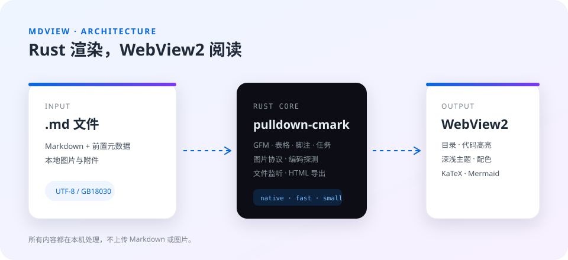
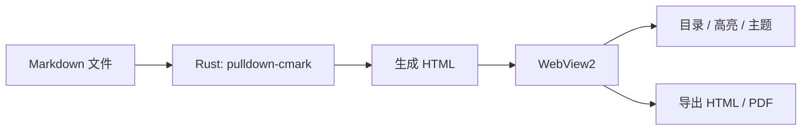

# mdview 功能演示

这是一个使用 **Rust** 和 Windows 内置 **WebView2** 构建的本地 Markdown 阅读 / 编辑工具。它专注于“打开即读”，也支持就地编辑和源码分屏，无需把文件上传到任何服务器。

> 提示：右侧目录会自动跟随滚动高亮。按 `Ctrl+B` 可以显示或隐藏目录。

## 快速开始

1. 双击任意 `.md` 文件
2. 或按 `Ctrl+O` 打开文件
3. `Ctrl+N` 新建阅读窗口
4. `F2` 就地编辑，`F3` 源码分屏
5. 按 `Ctrl+P` 无对话框导出 PDF
6. 按 `Esc` 退出编辑或关闭窗口

编辑器保存文件后，mdview 会自动检测修改并刷新，滚动位置会尽量保留。

### 多窗口与编辑

- **多窗口**：`Ctrl+N` 打开空白窗口；`Ctrl+Shift+O` 可直接在新窗口打开文件。
- **F2 就地编辑**：正文变成可编辑区域，约 0.9 秒自动保存；`F2` / `Esc` 完成。
- **F3 源码分屏**：左侧完整 Markdown，右侧实时预览，滚动同步，自动保存。
- **无对话框 PDF**：`Ctrl+P` 直接在文档同目录生成 PDF；已存在时自动编号，不覆盖旧文件。
- **系统打印**：需要选择打印机时用 `Ctrl+Shift+P`。

```text
F2  → 点击正文直接改，自动写回 .md
F3  → 左源码 / 右预览，适合改公式和 Mermaid
Ctrl+P → 当前目录生成 文件名.pdf（不弹保存框）
```

### 代码高亮

```rust
use std::path::Path;

fn main() {
    let doc = Path::new("README.md");
    println!("opening {}", doc.display());
}
```

```javascript
const viewer = {
  theme: "system",
  async open(path) {
    const response = await fetch(path);
    return response.text();
  },
};
```

### 表格与任务列表

| 功能 | 社区版 | 说明 |
| --- | :---: | --- |
| 文档目录 | ✓ | 滚动自动高亮 |
| 代码高亮 | ✓ | 离线 highlight.js |
| 本地图片 | ✓ | 不读取网络 |
| 深色模式 | ✓ | 跟随系统 / 手动切换 |
| 导出 HTML | ✓ | 图片内嵌为 base64 |
| 数学公式 | ✓ | KaTeX |
| Mermaid | ✓ | 流程图 / 时序图 |

- [x] 双击打开
- [x] 拖放打开
- [x] 自动刷新
- [ ] 你正在阅读的这一项

### 本地图片

图片会从 Markdown 所在目录加载，并通过应用内部协议提供给 WebView2：



### 数学公式

行内公式：当 $a \ne 0$ 时，方程 $ax^2 + bx + c = 0$ 的解为：

$$
x = \frac{-b \pm \sqrt{b^2 - 4ac}}{2a}
$$

### Mermaid 图表



### 引用与脚注

> 阅读界面，没有一个图标和按钮，只留下内容本身。
>
> —— mdview 的设计目标

这是一个脚注示例[^1]。

[^1]: 脚注也会被正确渲染并链接回正文。

---

## 为什么用 Rust + WebView2？

- **启动快**：原生窗口 + 系统 WebView2，不需要打包整个 Chromium。
- **体积小**：渲染逻辑在 Rust 中完成，前端资源离线内置。
- **本地优先**：Markdown、图片和公式都在本机处理，文件不出本机。
- **可扩展**：Rust 负责文件、窗口、导出和关联，WebView2 负责排版与交互。

```powershell
# 构建
.\build.bat build --release

# 运行
.\target\release\mdview.exe .\examples\demo.md

# 注册 .md 文件关联（当前用户）
.\target\release\mdview.exe --register
```

## 快捷键

| 快捷键 | 功能 |
| --- | --- |
| `Ctrl+N` | 新建窗口 |
| `Ctrl+Shift+O` | 在新窗口打开 |
| `Ctrl+O` | 打开文件 |
| `Ctrl+R` | 重新加载 |
| `F2` | 就地编辑 / 完成 |
| `F3` | 源码分屏 / 完成 |
| `Ctrl+S` | 编辑中立即保存 |
| `Ctrl+B` | 目录 |
| `Ctrl+D` | 切换主题 |
| `Ctrl+E` | 导出单文件 HTML |
| `Ctrl+P` | 无对话框导出 PDF |
| `Ctrl+Shift+P` | 系统打印 |
| `Ctrl+,` | 阅读设置 |
| `Esc` | 退出编辑 / 关闭窗口 |

感谢阅读。更多 Markdown 使用方式，请参考 [mdview 官网](https://www.mdview.cn/)。
